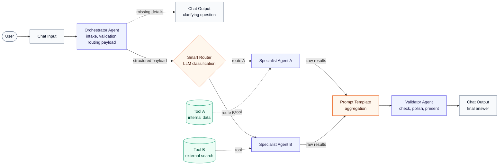

<!-- agent:brain -->
<!-- Commit convention: Conventional Commits with agent scope -->
<!-- Format: type(agent:brain): description -->
<!-- Tags: semantic versioning (v0.1.0, v1.0.0) -->
<!-- Branch: main (PRs for all changes) -->

# langflow-artifacts

Reusable Langflow flow exports by Swaroop Raj. This is the master repository for Langflow work: each project lives in its own folder with its own README and flow export, and this file summarizes every artifact in the repository.

Configure credentials, API keys, and resource identifiers in your own Langflow instance before running any flow. Exports in this repository are sanitized: no live credentials or private resource IDs are included.

## Project catalog

| Project | Files | Orchestration pattern | Purpose |
| --- | --- | --- | --- |
| [Doctor Appointment Orchestrator Agent](projects/doctor-appointment-orchestrator/) | `doctor-appointment-orchestrator.json` | Orchestrator, Router, Specialists, Validator | Collects a patient's healthcare need, routes it to a doctor-slot lookup agent (Google Sheets via Composio) or a hospital and emergency search agent (Google Serper), then validates and presents the result. |

## Repository structure

```text
langflow-artifacts/
├── README.md                          # Master catalog, patterns, conventions
└── projects/
    └── doctor-appointment-orchestrator/
        ├── README.md                  # Project-specific architecture and setup
        └── doctor-appointment-orchestrator.json
```

## Multi-agent orchestration pattern

The first project in this repository uses an **Orchestrator, Router, Specialists, Validator** pattern. It is a supervisor-style design: one agent owns the conversation with the user, a lightweight router picks the right specialist, specialists do narrow tool-backed work, and a final validator checks and presents the answer.



### What the pattern means

| Stage | Role | Langflow component | Why it exists |
| --- | --- | --- | --- |
| Intake | Understand the request, check the minimum required details, ask a clarifying question when details are missing, and emit a structured routing payload when they are complete. | Agent (Orchestrator) | Keeps the user conversation in one place and stops incomplete requests before they consume downstream tool calls. |
| Routing | Classify the payload into exactly one category and send it down that branch only. | Smart Router | Makes the handoff explicit and inspectable instead of hiding it inside one large agent's reasoning. |
| Specialist work | Execute narrow, tool-backed tasks and return raw, structured results without polishing them. | Agent plus a tool component | Each specialist has one job and only the tool it needs, which keeps prompts short and failures easy to isolate. |
| Aggregation | Merge specialist outputs into one labeled payload. | Prompt Template | Gives the validator a predictable input shape regardless of which branch ran. |
| Validation and presentation | Cross-check results against the user's original intent, handle empty or failed results honestly, and format the final answer. | Agent (Validator) | Separates data retrieval from presentation, and adds one last grounding check before anything reaches the user. |

In short, the orchestrator decides **whether** to act, the router decides **who** acts, specialists decide **how** to get the data, and the validator decides **what** the user sees.

### Design principles

- **Single responsibility per agent.** Every agent has one job and a prompt written only for that job. Intake, retrieval, and presentation are never mixed in one prompt.
- **Gate before you route.** The orchestrator validates minimum required inputs first. Incomplete requests get a clarifying question, not a speculative tool call.
- **Explicit handoff contracts.** Agents pass structured payloads with fixed headings (target route, collected details, downstream instructions, raw results). The contract is the interface; treat changes to it like an API change.
- **Route cheap, reason strong.** Classification runs on a smaller model (`gpt-4o-mini`), while agents that use tools or write for the user run on a stronger model (`gpt-4o`). Spend capability where judgment is needed.
- **Least-privilege tools.** Each specialist gets only the tool it needs, and only the actions it needs. The Google Sheets connector exposes a single read action, so the lookup agent cannot modify the sheet.
- **Raw in the middle, polish at the edge.** Specialists return unformatted data; only the validator writes consumer-facing text. This keeps intermediate outputs machine-checkable and avoids double rewriting that can distort facts.
- **Zero fabrication at every layer.** Each prompt forbids inventing names, slots, addresses, or IDs. The validator reports gaps and failures transparently instead of filling them in.
- **Guardrails are layered, not centralized.** Scope limits, confidentiality, tone, and no-diagnosis rules are restated in the agents that face users, so one weak prompt does not open the whole flow.
- **Humans own irreversible actions.** Read-only lookups run automatically. Anything that commits on the user's behalf, such as writing a booking, should require explicit user confirmation before execution.
- **Observable and replaceable parts.** Each node can be run and inspected in the Langflow Playground, and any specialist can be swapped or added without rewriting the orchestrator, only the router table and its contract.

### When to use it, and when not to

Use this pattern when requests fall into a small number of clearly different intents, each intent needs different tools or data sources, and the final answer benefits from a consistent validation and formatting step.

Avoid it for single-intent tasks where one agent with one tool is enough, or for latency-critical paths. A full turn here costs up to four model calls (orchestrator, router, specialist, validator) plus tool latency.

### Trade-offs to manage

| Trade-off | Impact | Mitigation |
| --- | --- | --- |
| Latency and cost | Several sequential LLM calls per turn | Small router model, short specialist prompts, skip downstream calls when the intake gate fails |
| Error compounding | A wrong route or a dropped field propagates downstream | Fixed payload contracts, router categories named exactly as the orchestrator emits them, validator cross-checks against the original request |
| Contract drift | Editing one prompt can silently break the next agent's parsing | Version prompts with the flow export, and keep test prompts per route in each project README |
| Branch coverage | Off-topic or ambiguous turns may match no route | Use an explicit fallback (else) route back to the user |

## Importing a flow into Langflow

1. Open Langflow and choose **Upload a flow** (or drag the `.json` file onto the canvas or project page).
2. Check the version note in the project README. Exports record the Langflow version they were tested with; newer versions may prompt you to update components.
3. Re-enter every credential and API key (model provider, tool connectors). Sanitized exports contain empty keys and `REPLACE_WITH_...` placeholders.
4. Replace every placeholder resource identifier listed in the project README.
5. Run the project's test prompts in the Playground and inspect each node's output before sharing or deploying the flow.

## Adding a new project

- [ ] Create `projects/<project-name>/` using lowercase kebab-case.
- [ ] Add the sanitized flow export as `<project-name>.json`.
- [ ] Add a project `README.md` with: overview, flow diagram, component table, agent contracts, prerequisites, import steps, test prompts, known limitations, and sanitization notes.
- [ ] Add a row to the **Project catalog** above, including its orchestration pattern.
- [ ] If the project introduces a new orchestration pattern, document it in this file with its own diagram and principles.
- [ ] Open a pull request; do not commit directly to `main`.

## Public-export sanitization policy

Before any flow is committed:

- Remove inline API keys and tokens, including connector keys stored directly on components.
- Keep only environment-variable references for global variables (for example `OPENROUTER_API_KEY`), never their values.
- Replace private resource IDs (spreadsheets, folders, databases, recipients) with `REPLACE_WITH_...` placeholders, including occurrences inside agent prompts.
- Retain flow logic, node IDs, edges, prompts, and model settings so the flow imports and behaves as designed.
- Use mock or synthetic data only. No patient, customer, or personal data is stored in this repository.

## Conventions

- Commits follow Conventional Commits with agent scope where applicable, for example `docs(agent:brain): add project readme`.
- All changes go through pull requests against `main`.
- Releases use semantic version tags (`v0.1.0`, `v1.0.0`) when a set of projects is ready to publish.
