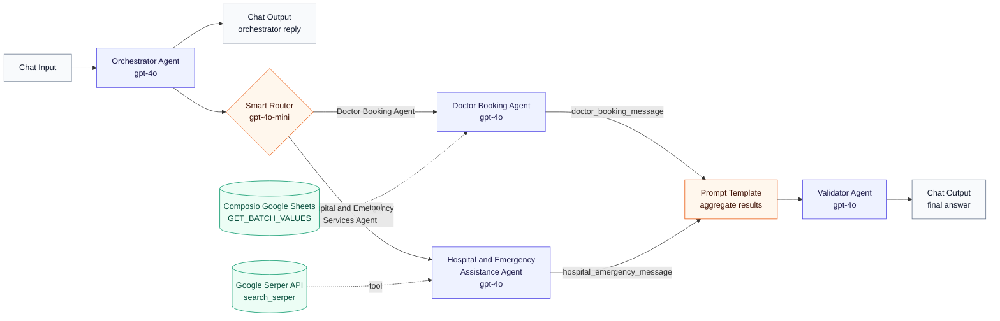
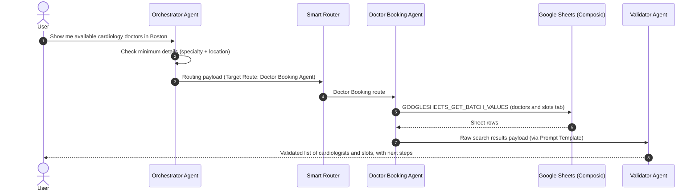

<!-- agent:brain -->
<!-- Commit convention: Conventional Commits with agent scope -->
<!-- Format: type(agent:brain): description -->
<!-- Tags: semantic versioning (v0.1.0, v1.0.0) -->
<!-- Branch: main (PRs for all changes) -->

# Doctor Appointment Orchestrator Agent

A Langflow multi-agent flow that acts as a healthcare front desk. It collects what the user needs, routes the request to the right specialist agent, and returns a validated, consumer-friendly answer:

- **Doctor appointment requests:** look up available doctors and appointment slots from a Google Sheet (mock US healthcare data) through Composio.
- **Hospital and emergency requests:** search for hospitals, clinics, urgent care, and emergency facilities through the Google Serper API.

[Back to the master catalog](../../README.md)

## At a glance

| Item | Value |
| --- | --- |
| Export | `doctor-appointment-orchestrator.json` |
| Langflow version (tested) | 1.11.1 |
| Pattern | Orchestrator, Router, Specialists, Validator |
| Components | 11 nodes, 11 edges |
| Agents | 4 (Orchestrator, Doctor Booking, Hospital and Emergency, Validator) |
| Models | `openai/gpt-4o` for agents, `openai/gpt-4o-mini` for the Smart Router, both through OpenRouter |
| Tools | Composio Google Sheets (`GOOGLESHEETS_GET_BATCH_VALUES`, read only), Google Serper API (`search_serper`, 4 results) |
| Data | Mock doctors and appointment slots sheet. No real patient data. |

## Flow diagram



## Components

| Node | Langflow component | Responsibility | Input | Output |
| --- | --- | --- | --- | --- |
| Chat Input | Chat Input | Receives the user message (sample: `Show me available cardiology doctors in Boston.`). | User | Orchestrator |
| Orchestrator Agent | Agent | Executive medical assistant. Checks minimum details, asks for missing ones, and emits the structured routing payload. | Chat Input | Smart Router, Chat Output |
| Smart Router | Smart Router | LLM-based classification into one of two routes. Else output is disabled. | Orchestrator | Doctor Booking or Hospital and Emergency agent |
| Doctor Booking Agent | Agent + Composio Google Sheets tool | Reads the doctors and slots sheet, filters by specialty, location, and preferred slot, returns raw matches. | Router route 1 | Prompt Template |
| Hospital and Emergency Assistance Agent | Agent + Google Serper tool | Searches for matching facilities and returns raw facility details. | Router route 2 | Prompt Template |
| Prompt Template | Prompt Template | Labels and merges both specialist outputs into one payload. | Both specialists | Validator |
| Validator Agent | Agent | Cross-checks results against the original request, handles gaps, and writes the final answer. | Prompt Template | Chat Output |
| Chat Output (x2) | Chat Output | Displays the orchestrator reply and the final validated answer in the Playground. | Orchestrator, Validator | User |

All four agents keep Langflow defaults for this export: chat memory of 100 messages, 15 max iterations, streaming on, parse-error handling on, and the built-in Current Date and Calculator tools enabled.

## How a request moves through the flow



If the request is missing a minimum detail (for example a cardiologist request without a city), the orchestrator is instructed not to route and to ask the user for the missing detail instead.

## Routing rules

| Route | Minimum details | Triggered by | Specialist tool |
| --- | --- | --- | --- |
| Doctor Booking Agent | Specialty and location (city or state). Patient name and preferred slot optional. | Checking available doctors, viewing slots, booking requests | Google Sheets read (`GOOGLESHEETS_GET_BATCH_VALUES`) |
| Hospital and Emergency Services Agent | Location (city, state, or ZIP) and service or facility needed | Hospitals, clinics, urgent care, emergency services | Google Serper web search |
| No route | Not applicable | Small talk, off-topic, or incomplete requests | None; the orchestrator replies directly |

## Agent contracts

The agents communicate through fixed text payloads. Treat these as interfaces: if you change one, update the receiving agent's prompt too.

### Orchestrator to Smart Router

```text
**Target Route:** Doctor Booking Agent | Hospital & Emergency Services Agent
**Routing Intent:** Route for getting doctor slots and booking doctor appointments | Route for hospital and emergency services queries

**Collected User Details:**
- **Patient Name:** <name or "Not Provided">
- **Specialty / Service Needed:** <e.g. Cardiologist, Emergency Room>
- **Location:** <city, state, and/or ZIP>
- **Preferred Date/Time Slot:** <preference or "Any Available">
- **User Query Summary:** <one sentence>

**Downstream Agent Instructions:** <tool to use and no-fabrication rule>
```

### Specialists to Validator

```text
### Raw Search Results Payload
- **Search Criteria Match Status / Search Status:** <Exact Match Found | Alternative Slots Found | No Match Found | Search Successful | No Results Found>
- **Requested Specialty or Service:** <from input>
- **Requested Location:** <from input>
- **Requested Preferred Slot:** <doctor route only>

**Matching Records / Facilities:** <raw rows or facility details, not rewritten>
```

### Prompt Template (aggregation)

```text
Doctor Booking Results:
{doctor_booking_message}

Hospital & Emergency Results:
{hospital_emergency_message}
```

## Prerequisites

- Langflow **1.11.1** or a compatible later version. Newer versions may ask you to update the Agent, Smart Router, or connector components after import.
- An **OpenRouter** API key stored as the Langflow global variable `OPENROUTER_API_KEY` (all agents and the Smart Router reference it).
- A **Composio** account and API key, with the Google Sheets integration authorized through OAuth2.
- A **Google Sheet** with a tab named `US Healthcare - Doctors & Appointment Slots Mock Data`. The agent prompt expects doctor name, hospital or clinic name, city, available slots, and fees or notes columns. Use mock data only.
- A **Serper.dev** API key for the Google Serper API component.

## Import and configure

1. Import `doctor-appointment-orchestrator.json` into Langflow.
2. Create or confirm the global variable `OPENROUTER_API_KEY`.
3. On the **GoogleSheets** component, enter your Composio API key, complete OAuth2 authorization, and confirm that only **Batch get spreadsheet** (`GOOGLESHEETS_GET_BATCH_VALUES`) is enabled.
4. Replace `REPLACE_WITH_DOCTOR_SLOTS_SPREADSHEET_ID` everywhere it appears: the GoogleSheets component's spreadsheet ID, the Orchestrator Agent instructions, and the Doctor Booking Agent instructions.
5. On the **Google Serper API** component, enter your Serper API key.
6. Open the Playground and run the test prompts below. Inspect each node's output, especially the router's selected branch and the payload each specialist receives.

## Test prompts

| Prompt | Expected behavior |
| --- | --- |
| `Show me available cardiology doctors in Boston.` | Doctor Booking route, sheet lookup, list of Boston cardiologists and slots |
| `Book me a dermatologist in Chicago next Tuesday morning.` | Doctor Booking route, exact match or alternative slots, no fabricated times |
| `Find the nearest emergency room in Austin, TX 78701.` | Hospital and Emergency route, Serper search, facility names and details |
| `I need a cardiologist.` | No route; orchestrator asks for the location |
| `What's the weather today?` | No route; brief off-topic reply |

## Known limitations and review checklist

These findings come from a static review of the export. No live Langflow run, provider authentication, or tool call was executed as part of this commit.

- **Lookup, not booking.** The only enabled Sheets action reads values. The flow surfaces available slots but does not write or confirm a booking. Booking write-back with explicit user confirmation is the planned next iteration.
- **Router output values are fixed strings.** Both routes define an Output Value equal to the route description. In Smart Router, a route's output value can replace the message passed downstream. Confirm in the Playground that each specialist receives the orchestrator's full routing payload; if it receives only the description, clear the Output Value fields so the input message passes through.
- **Orchestrator output always reaches the router.** The orchestrator response is wired to both a Chat Output and the Smart Router, so clarifying questions and off-topic replies are also classified. The router's else output is disabled, so there is no explicit fallback branch. Consider enabling it and connecting it to a Chat Output.
- **Single-branch aggregation.** The Prompt Template has inputs from both specialists, while only one branch runs per turn. Verify the Validator still executes on single-route turns in your Langflow version.
- **Naming alignment.** The hospital agent is named `Hospital & Emergency Assistance Agent` while the route is `Hospital & Emergency Services Agent`, and its prompt references `SEARCH_SERPER` while the tool is exposed as `search_serper`. Aligning names reduces routing and tool-selection ambiguity.
- **Emergency safety message.** The flow does not instruct users to call emergency services for urgent symptoms. Add an explicit emergency escalation line (for example, call 911 in the US) to the orchestrator and validator prompts before any real-world use.
- **Not for clinical or PHI use.** This is a learning and demonstration flow using mock data. It is not HIPAA-reviewed, and the validator is instructed not to provide diagnoses or prescriptions.
- **Search results are unverified.** Facility details from web search can be outdated. The validator presents them as found; it does not verify phone numbers or hours.

## Roadmap

- [ ] Booking write-back to the sheet, gated by explicit user confirmation
- [ ] Else route for off-topic and incomplete turns
- [ ] Pass-through router outputs with the full payload
- [ ] Emergency escalation guardrail
- [ ] Structured JSON contracts between agents
- [ ] Regression test prompts per route

## Public-export sanitization

- The inline Composio API key stored on the GoogleSheets component was removed. **If this export was ever shared outside your Langflow instance with the key in place, rotate that key.**
- The private Google Sheets spreadsheet ID was replaced with `REPLACE_WITH_DOCTOR_SLOTS_SPREADSHEET_ID` in the component and in both agent prompts.
- The Langflow folder ID was cleared.
- Model API keys remain environment-variable references (`OPENROUTER_API_KEY`) with no values.
- Flow logic, node IDs, edges, prompts, model settings, and component code were retained unchanged.
